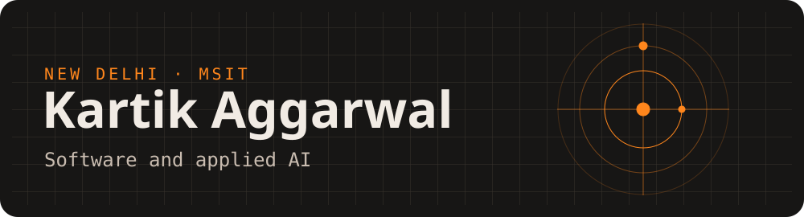

# Kartik Aggarwal

**Third-year B.Tech Information Technology student · MSIT, New Delhi**

[Portfolio](https://kartik-githubs.github.io/) · [LinkedIn](https://www.linkedin.com/in/kartik-aggarwal25/) · [Email](mailto:kartik.aggarwal199@gmail.com)

## About me

I like building software that helps someone make a decision. With Solaris, that meant turning a rooftop and an electricity bill into a sizing and payback estimate. With AgriCycle AI, it meant comparing crop-residue options against the resources available nearby.

I also help run campus placement drives at MSIT, where I coordinate scheduling, participant records, and communication for drives involving 100+ students per company.

## Selected work

| Project | What you’ll find |
| :--- | :--- |
| [**Solaris**](https://github.com/KARTIK-githubs/Solaris----Dheera-Green-Infra) | A 13-route prototype for sizing rooftop systems, estimating payback and distributing shared solar credits. Developed with Dheera Green Infra. |
| [**AgriCycle AI**](https://github.com/KARTIK-githubs/AgriCycle-AI) | Compare crop-residue options by cost, distance, machinery availability and user priorities. |
| [**VentureArchitect AI**](https://github.com/KARTIK-githubs/VentureArchitect-AI) | Five agents take a startup idea through validation, market research, business modelling, risk and pitch development. |
| [**Akashvaani AI**](https://github.com/KARTIK-githubs/Akashvaani-AI) | A team prototype for extracting applicant details from documents and matching them against public schemes. |
| [**INDIMON**](https://github.com/KARTIK-githubs/indi-mon) | A team-built Indian monument classifier with a runnable upload interface. |
| [**WitTrade**](https://github.com/KARTIK-githubs/WitTrade) | A team-built marketplace where startups publish projects and learners apply. |

## Tech stack

**Web:** TypeScript, React, Tailwind CSS, Vite  
**Backend:** Node.js, Express, Flask, REST APIs, MongoDB, SQL  
**Applied AI:** Python, TensorFlow, Groq, IBM watsonx.ai

## Contributions

[See my GitHub contribution activity](https://github.com/KARTIK-githubs?tab=overview#contribution-activity).

## Outside the code

- Placement Coordinator at Maharaja Surajmal Institute of Technology
- Top 10 at the DevDay Exchange Community Hackathon, IIIT Delhi
- Top 10 at HackHatch 2025 and Top 6 at HackQuanta 2025
